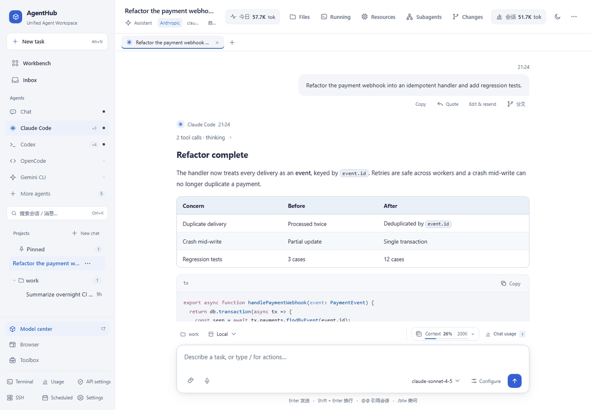
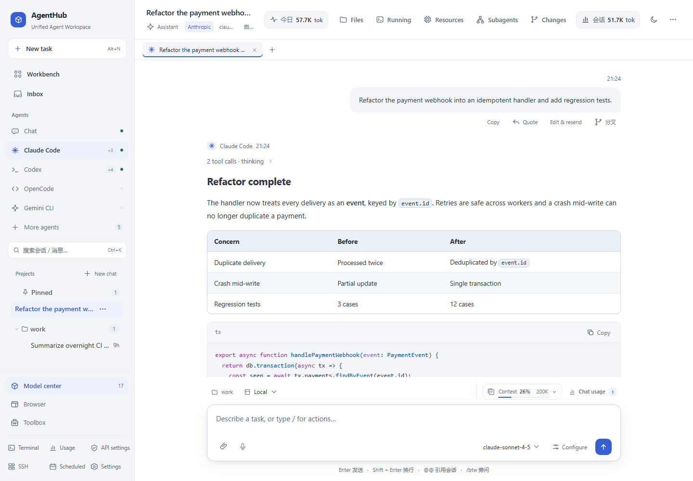
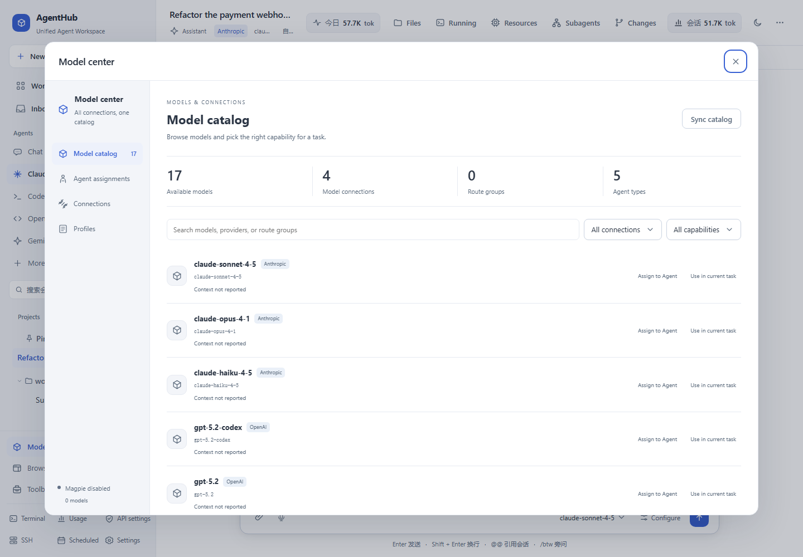
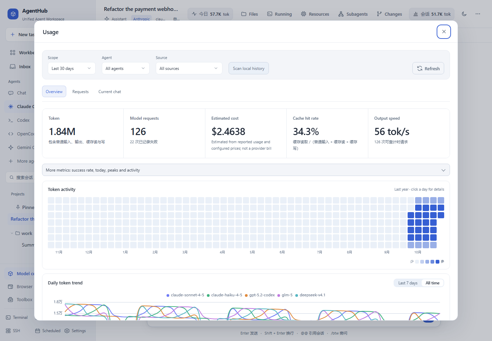
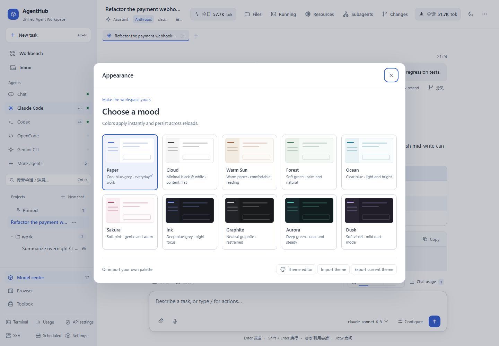
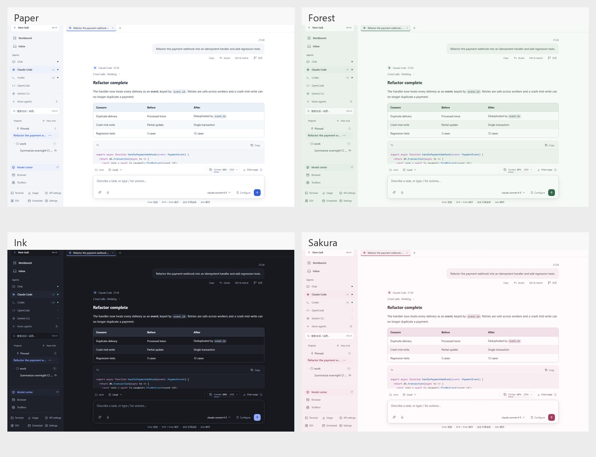
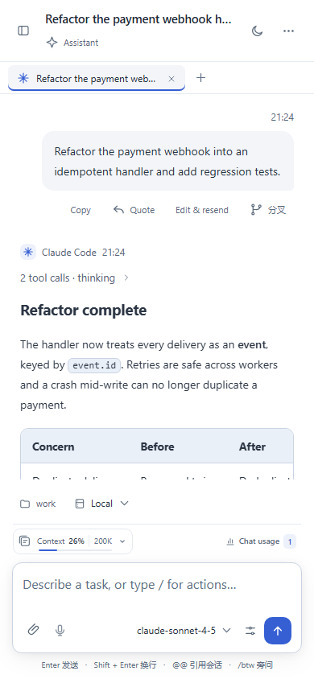
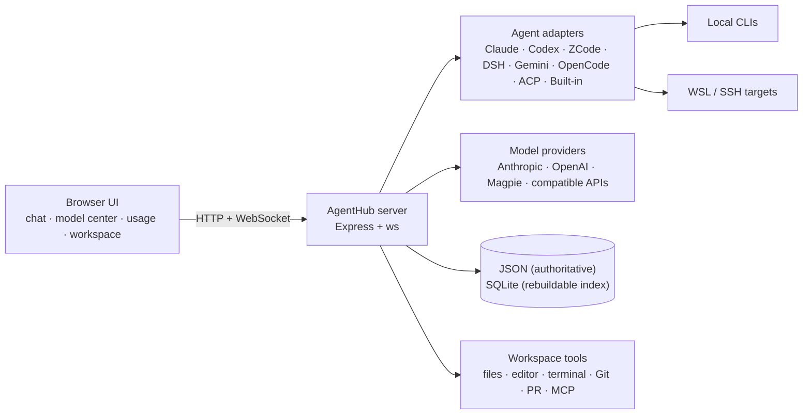

<h1 align="center">AgentHub</h1>

<p align="center">
  <b>One local workspace for every coding agent.</b><br>
  Claude Code · Codex · ZCode · DeepSeek Harness · Gemini CLI · OpenCode · Built-in Agent · Custom
</p>

<p align="center">
  <a href="https://github.com/1181110317/agenthub"></a>
  
  
  
</p>

<p align="center">
  <a href="docs/assets/demo.gif"></a>
</p>

<p align="center">
  <sub>Chat, model center, usage accounting and themes — all in one local workspace. Screenshots use an isolated demo dataset.</sub>
</p>

AgentHub brings multiple coding agents into one browser-based workspace. Each agent keeps its own native session protocol, while AgentHub adds a shared chat timeline, model routing, workspace files, Git/PR tools, terminals, remote hosts, scheduled tasks and token accounting. Everything runs locally: no cloud account, no external database, no build step for the front end.

## Highlights

- **Every agent, one window** — Claude Code, Codex, ZCode, DeepSeek Harness, Gemini CLI, OpenCode, custom CLI/ACP agents, a built-in agent and a ChatGPT-style chat mode share one UI, one project list and one keyboard model.
- **Native bridges, not screen scraping** — Claude speaks `--input-format stream-json`, Codex and ZCode use their official `app-server` protocols, and DeepSeek Harness uses `dsh headless --json`. Permissions, questions, model choice and usage events flow both ways.
- **A real model center** — search a unified catalog of context length, vision, reasoning and routing metadata; assign models per agent; save reusable profiles; connect Magpie or any Anthropic/OpenAI-compatible API.
- **A workspace, not just a chat box** — browse and edit files, preview diffs, inspect Git changes, create commits and PRs, run durable terminals and monitor CPU/GPU/network usage without leaving the conversation.
- **Remote and WSL first-class** — manage SSH hosts, stream remote sessions, preview images over SSH, run target-side file operations and share the same workflow across local, WSL and remote projects.
- **Local-first and inspectable** — JSON is the authoritative store, SQLite is a rebuildable index, credentials are encrypted at rest, and the optional WebUI account layer adds CSRF protection and login rate limits.

## Screenshots

| Chat & agent timeline | Model center |
| --- | --- |
| [](docs/assets/showcase-chat.png) | [](docs/assets/showcase-model-center.png) |
| **Usage & cost accounting** | **Ten built-in themes** |
| [](docs/assets/showcase-usage.png) | [](docs/assets/showcase-themes.png) |

<p align="center">
  <a href="docs/assets/theme-wall.jpg"></a><br>
  <sub>Paper · Forest · Ink · Sakura — every panel, terminal and diagram follows the selected palette.</sub>
</p>

<p align="center">
  <br>
  <sub>On narrow screens the sidebar becomes a drawer while the composer, usage meter and conversation stay usable.</sub>
</p>

## Feature tour

### Agents & sessions

- **Multi-agent switch** — a dedicated session list for each agent, with capability chips that only appear when the backend really detects the corresponding bridge.
- **Native session recovery** — persistent Claude, Codex and ZCode bridges; rewind, retry and fork use native session history where available, with a bounded replay fallback only when necessary.
- **DeepSeek Harness adapter** — `dsh headless --json -` maps committed conversation, tool and usage events into the timeline; `--session-id` resumes turns. DSH keeps its own model, provider and permission profile.
- **ACP discovery** — probes candidate CLIs for a real `acp` subcommand and registers only those that advertise it (Qwen Code, CodeBuddy, Cursor Agent, Copilot, Goose and more).
- **Session operations** — pin, unread state, multi-select, bulk archive/settle/delete, cross-session mentions with `@@`, and project-scoped defaults.
- **Per-session runtime** — agent, provider, model, reasoning effort, permission mode, working directory and local/WSL/SSH location are saved per conversation.

### Chat experience

- **Chronological timeline** — commentary, thinking, tool calls and the final answer keep their real order while streaming and after reload. Completed steps fold into a compact activity summary and can be expanded later.
- **Markdown, math and diagrams** — local CommonMark parsing with nested lists, task lists, tables, footnotes and relative document images; KaTeX rendering for `$…$`, `$$…$$`, `\(…\)` and `\[…\]`; Mermaid and WaveDrom with source view and copy.
- **Code that stays useful** — syntax highlighting, exact-copy code blocks, runnable shell/Python snippets, file-diff chips with undo, and image previews.
- **Find your place** — in-session search (`Ctrl+F`) across collapsed steps, a per-turn navigation rail, conversation outline, and `Ctrl+Shift+P` command palette for everything.
- **Responsive by design** — 10 themes, 85%–130% UI scaling, a collapsible sidebar, and a phone layout with drawer navigation.
- **Side questions and scheduled prompts** — `/btw` asks a one-off question without polluting the timeline; scheduled tasks can continue a chat or start a fresh one and record per-run history.

### Models, providers & accounting

- **Unified model catalog** — context window, vision input, reasoning levels, routing groups and provider health in one place; search, filter and assign models from the Model Center.
- **Agent model routes** — save named profiles for Claude, Codex, ZCode, the built-in agent and chat; apply a profile to new sessions without touching existing ones.
- **Provider presets** — 17 platform presets (including local Ollama and LM Studio), real health checks with latency, and encrypted API keys.
- **Shared gateway** — an authenticated loopback gateway translates Messages, Responses and Chat protocols, including tools, images and streaming. Magpie is auto-discovered at `127.0.0.1:3425`.
- **Token and cost accounting** — today / last N days / all time, daily charts, agent/model/provider/session/project breakdowns, CSV export, cache-hit rate, TTFT and measured decode speed.
- **Context and quota visibility** — a context-window meter with 1M/1.024M/2M/4M presets, provider quota badges, and `/usage-limits` snapshots that do not spend a model turn.

### Workspace, Git & remote

- **Files and editor** — lazy workspace tree, filename search, create/rename/move/delete (moved to `data/trash/`), copy path, reveal in Explorer, open with VS Code or terminal.
- **Built-in editor** — edit text, Markdown and code in place with `Ctrl+S`, mtime conflict detection, split-screen Markdown preview and dirty-tab protection.
- **Preview upgrades** — highlighted source preview, download/save-as, system-app open, file-manager reveal and auto-refresh when an agent rewrites a file.
- **Git changes center** — staged/working/untracked line counts, patch previews for modified/deleted/renamed/new files, branch switching, fast-forward pull, fetch and stash, checkpoints and one-click PR creation.
- **GitHub PR workspace** — CI status, diffs, local review drafts, inline comments, metadata and merge/draft/reopen actions with stale-head protection and persistent write receipts.
- **Durable terminals** — reconnect or refresh to attach to the same shell; one page controls input, other viewers can explicitly take over; history survives service restarts.
- **Local and SSH resource monitor** — CPU, memory, NVIDIA GPU/VRAM and per-interface network rates, with explicit unknown states instead of invented zeroes.
- **Remote workspace** — SSH host manager, first-class WSL, target-side file operations, immutable turn diffs and remote Git workflows.

### Automation & collaboration

- **Assistants and skills** — 12 built-in roles plus custom assistants with prompt, model, permission and reasoning defaults; per-session skill selection in Toolbox → Runtime.
- **Third-party MCP servers** — stdio and HTTP servers, JSON import, auto-detection from Claude/Codex configs, real connection tests, encrypted OAuth credentials and masked secrets.
- **Task queue and templates** — editable review/testing/documentation/release templates, parameter previews, project profiles and explicit sending.
- **Saved plans** — save or download plans from a conversation card, then create an implementation draft with the original project and agent configuration.
- **Event triggers and schedules** — cron, weekly/weekday/monthly patterns and one-shot schedules with notifications, per-run history and missed-run catch-up.
- **Agent handoff and subagents** — preview context, continue a task with another agent, and inspect delegated work in the subagents panel.
- **Shared browser and speech input** — dock a controllable browser beside the chat, take over input, pick elements or capture diagnostics; dictate prompts in Chrome/Edge.

### Data & security

- **Local-first persistence** — JSON remains authoritative; SQLite mirrors sessions, messages, events and usage as a rebuildable index (`AGENTHUB_DB=0` disables it).
- **Encrypted secrets at rest** — SSH, MCP, speech, code-host, event and model-center records use AES-256-GCM with per-store keys kept beside the data directory.
- **Optional WebUI accounts** — scrypt-hashed passwords, httpOnly session cookies, CSRF double-submit headers, per-IP login rate limits and key rotation on password change.
- **Operator controls** — shared `AGENTHUB_TOKEN`, read-only `AGENTHUB_RO_TOKEN`, trusted-host checks, loopback-only defaults and explicit permission modes.
- **Portable data** — export includes encrypted credential records but excludes their encryption keys; unreadable ciphertext is preserved rather than overwritten.

## Quick start

### Requirements

- **Node.js ≥ 22.19.0** (the server uses the built-in `node:sqlite`).
- Windows 10/11 is the primary target for the bundled `start-server.cmd`; the Node entry point can also run on macOS/Linux where the underlying agent CLIs are available.
- Optional: the CLI for each agent you want to use (see [Supported agents](#supported-agents)).

### Install and run

```bash
git clone https://github.com/1181110317/agenthub.git
cd agenthub
npm install
npm start
```

Open **http://127.0.0.1:7261** (loopback only by default).

On Windows, you can also double-click **`start-server.cmd`**. It shows runtime checks, the service PID, HTTP readiness and live server errors, and appends both output streams to `data/logs/server.log`. Set `AGENTHUB_NO_PAUSE=1` for unattended launches.

### LAN / phone access

```bash
AGENTHUB_HOST=0.0.0.0 AGENTHUB_TOKEN=choose-a-secret npm start
```

Then open `http://<your-ip>:7261/?token=choose-a-secret`.

PowerShell:

```powershell
$env:AGENTHUB_HOST = '0.0.0.0'
$env:AGENTHUB_TOKEN = 'choose-a-secret'
npm start
```

Add `AGENTHUB_RO_TOKEN=another-secret` for view-only devices: they can watch sessions and progress but cannot send, approve permissions, open terminals or change settings.

## Supported agents

| Agent | What runs | Requires |
| --- | --- | --- |
| **Claude Code** | Native `claude` stream-json bridge | `claude` CLI on the local machine, WSL or SSH target |
| **Codex** | Native `codex app-server --stdio` | `codex` CLI on the target |
| **ZCode** | Official `app-server` protocol | ZCode with `app-server` support |
| **DeepSeek Harness** | `dsh headless --json -` | `dsh` CLI; keeps its own profile |
| **Gemini CLI** | Raw CLI stream adapter | `gemini` CLI |
| **OpenCode** | Raw CLI stream adapter | `opencode` CLI |
| **Built-in Agent** | Local engine, no CLI | Nothing extra; configure an Anthropic/OpenAI-compatible provider |
| **Custom / ACP** | Command template or ACP discovery | Any CLI that speaks the selected protocol |

## Configuration

| Variable | Default | Purpose |
| --- | --- | --- |
| `AGENTHUB_PORT` | `7261` | HTTP/WS port |
| `AGENTHUB_HOST` | `127.0.0.1` | Bind address; use `0.0.0.0` for LAN |
| `AGENTHUB_TOKEN` | — | Shared access token; required for non-loopback access |
| `AGENTHUB_RO_TOKEN` | — | Read-only token for phones and observers |
| `AGENTHUB_DATA_DIR` | `./data` | Sessions, usage, credentials and logs |
| `AGENTHUB_WORKSPACE` | `~/AgentHub` | Default workspace when a session has no directory |
| `AGENTHUB_DB` | on | Set to `0` to disable the SQLite mirror |
| `AGENTHUB_BROWSER` | auto | Chrome or Edge path for the docked browser |
| `AGENTHUB_MAGPIE_URL` | `http://127.0.0.1:3425/v1` | Magpie gateway address |
| `AGENTHUB_ALLOWED_HOSTS` | — | Extra trusted Host headers for reverse proxies |
| `AGENTHUB_MAX_ACTIVE_SESSIONS` | `500` | Active-session cap before archival |
| `AGENTHUB_TERMINAL_IDLE_MS` | `1800000` | Idle terminal retention (30 minutes) |
| `AGENTHUB_NO_PAUSE` | — | `1` prevents the Windows launcher from pausing on exit |

## Architecture



The front end is a zero-build vanilla SPA (`public/`); the server is Node.js + Express + WebSocket. Agent adapters sit behind one event model, so the browser does not need to know which CLI produced a thought, tool call or usage record.

## Directory

```text
agenthub/
├─ server.js                 # Express + WebSocket server (API, chat, terminal, preview)
├─ lib/
│  ├─ agents.js              # Agent adapters (Claude / Codex / ZCode / DSH / Gemini / OpenCode / ACP)
│  ├─ api-agent.js           # Built-in agent engine (Anthropic + OpenAI compatible)
│  ├─ claude-bridge.js       # Claude Code native stream-json bridge
│  ├─ codex-bridge.js        # Codex app-server stdio bridge
│  ├─ zcode-bridge.js        # ZCode app-server bridge
│  ├─ acp-agent.js           # ACP preset integration
│  ├─ model-center.js        # Model catalog, routes and assignment profiles
│  ├─ provider-gateway.js    # Messages / Responses / Chat translation gateway
│  ├─ usage.js               # Usage records, pricing and aggregation
│  ├─ ssh.js                 # ssh2 pool / exec / shell
│  ├─ store.js               # JSON persistence
│  ├─ events.js              # Internal event bus
│  ├─ session-files.js       # Split message bodies per session
│  └─ ...                    # Git, workspace, MCP, permissions, scheduling, metrics
├─ public/                   # Vanilla SPA (HTML/CSS/JS + ECharts + xterm + Mermaid)
├─ test/                     # Syntax, logic, isolated API and browser regression tests
├─ docs/assets/              # README screenshots and demo GIF
└─ data/                     # Runtime data (gitignored)
```

## Validation

`npm test` runs the full registered suite: 95 scripts covering syntax, logic, API, protocol, durability and browser regressions. Browser checks require a local Chrome or Edge and report a skip when neither is available. Tests use isolated data directories; live provider credentials and real remote hosts are not required.

Useful focused commands:

```bash
node test/logic.js                 # usage normalization, cache accounting, markdown and protocol conversion
node test/provider-gateway.js      # Messages / Responses / Chat conversion
node test/remote-workspace-ssh.js  # SSH file ops, resource metrics, Git counts and turn diffs
npm run test:models                # model center, gateway protocols and docked browser
npm run test:expansion             # toolbox, target workspace and development workflows
```

See [CHANGELOG.md](CHANGELOG.md) for the implementation scope, known limits and latest changes. Vendored code attribution is in [THIRD-PARTY-LICENSES.md](THIRD-PARTY-LICENSES.md).

## License

ISC. See [THIRD-PARTY-LICENSES.md](THIRD-PARTY-LICENSES.md) for bundled third-party notices.
