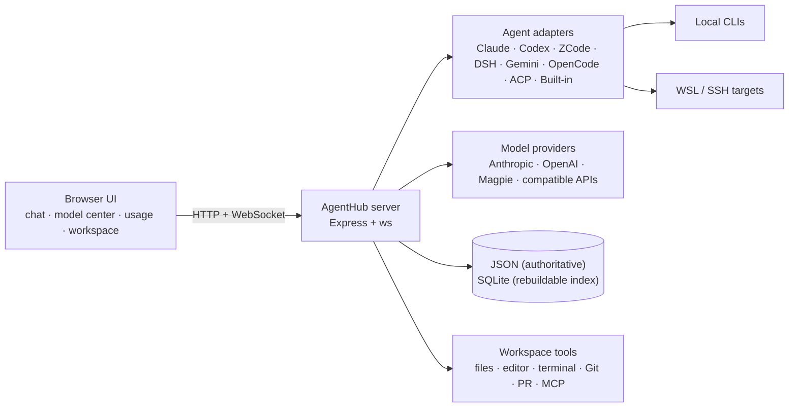
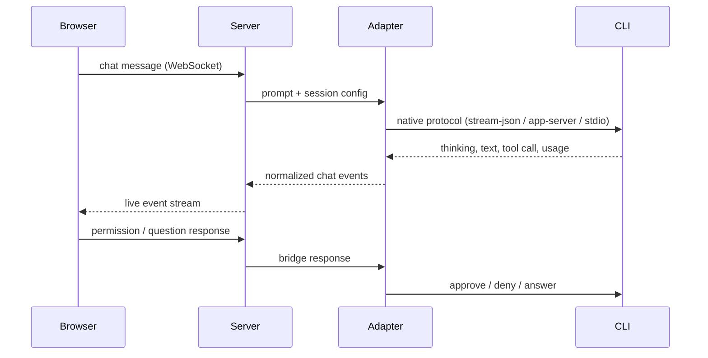

# Architecture

AgentHub is a single Node.js process serving a static browser application and proxying every agent through one event model.

## High-level view



## Browser

The front end is a zero-build vanilla SPA in `public/`:

- HTML/CSS/JavaScript, ECharts, xterm.js, Mermaid and a local highlight.js bundle.
- The browser talks to the server over `/api` and a single WebSocket connection.
- Server state is loaded at startup and then updated from chat events; the page does not poll for every message.
- The docked browser is a second, isolated headless Chrome/Edge instance controlled over CDP, not the user’s normal browser profile.

## Server

`server.js` owns HTTP routes, WebSocket handling, session persistence and most feature APIs. `lib/` contains the reusable pieces:

| Layer | Responsibility |
| --- | --- |
| **Agent adapters** | Convert CLI events into the shared chat event model and deliver prompts, permissions, questions and interrupts |
| **Model gateway** | Translate Anthropic Messages, OpenAI Responses and OpenAI Chat formats; handle tools, images and streaming |
| **Storage** | JSON stores, per-session message files, event logs and optional SQLite index |
| **Workspace** | File operations, editor, Git workflows, terminals and remote SSH/WSL execution |
| **Automation** | MCP servers, schedules, task queue, templates, assistants and event triggers |

## Agent adapter flow



Native adapters use the CLI’s own session identifiers where available:

- Claude: `--input-format stream-json` and `--permission-prompt-tool stdio`
- Codex: `app-server --stdio` with `thread/start`, `turn/start`, `turn/interrupt`
- ZCode: `app-server` with `session/create`, `session/resume`, `session/send`, `session/stop`
- DSH: `dsh headless --json -` with `--session-id`

Raw adapters (Gemini CLI, OpenCode, custom commands) parse line-oriented output; ACP agents use the Agent Client Protocol.

## Event model

Every chat event carries a **session id** and a per-session monotonic **seq**. The browser deduplicates by `(session, seq)` and can resume:

```text
GET /api/sessions/:id/events?since=<cursor>
```

- Live delta events stay in memory.
- Persisted events go to `data/events/<id>.jsonl`.
- A reconnect or device switch replays only the missing range.
- Multiple tabs can watch the same turn; a permission or question card can be answered from any one tab, and the server prevents duplicate responses.

## Storage

### JSON is authoritative

```text
data/
├─ sessions.json             # index: ids, metadata, summaries
├─ sessions/<id>.json        # message bodies (split for fast index writes)
├─ events/<id>.jsonl         # event stream for reload/replay
├─ usage.json                # records for cost and usage views
├─ providers.json            # provider catalogue (contains API keys; protect this file)
├─ settings.json             # UI/runtime preferences
└─ sessions-archive.jsonl    # archived sessions with message bodies
```

Session bodies are split from the index so appending a long conversation does not rewrite the entire session list. On startup, missing bodies are loaded from `data/sessions/<id>.json`; if a body is corrupted, AgentHub preserves the bad file and attempts a best-effort rebuild from the event log.

### SQLite is a rebuildable index

`data/agenthub.db` mirrors sessions, messages, turn events and usage for fast search and aggregation. It is not the source of truth:

- Set `AGENTHUB_DB=0` to disable it and fall back to JSON scans.
- Delete the `.db` file while the server is stopped to rebuild it.
- The connection is closed when idle so the data directory can be moved or deleted while the server runs.

## Security boundaries

- **Loopback by default.** A non-loopback bind requires a token or enabled WebUI accounts.
- **Host trust.** Unauthenticated requests must use an IP literal, `localhost` or `AGENTHUB_ALLOWED_HOSTS` entry to resist DNS rebinding.
- **CSRF.** WebUI account sessions use an httpOnly session cookie plus a double-submit CSRF header for writes.
- **Encrypted stores.** SSH, MCP, speech, code-host, event and model-center records use AES-256-GCM with per-store keys. Provider API keys in `providers.json` are not encrypted by this layer; protect the data directory accordingly.
- **Permission modes.** Tool use and shell commands can be gated per session; remembered allowances are scoped to project + agent + tool.

## Directory layout

```text
agenthub/
├─ server.js                 # HTTP/WS server and API routes
├─ lib/
│  ├─ agents.js              # Agent adapters
│  ├─ api-agent.js           # Built-in agent engine
│  ├─ claude-bridge.js       # Claude stream-json bridge
│  ├─ codex-bridge.js        # Codex app-server bridge
│  ├─ zcode-bridge.js        # ZCode app-server bridge
│  ├─ acp-agent.js           # ACP presets
│  ├─ model-center.js        # Model catalogue and assignments
│  ├─ provider-gateway.js    # Protocol translation
│  ├─ usage.js               # Usage records and aggregation
│  ├─ ssh.js                 # SSH pool / exec / shell
│  ├─ store.js               # JSON persistence
│  ├─ session-files.js       # Per-session message bodies
│  └─ ...                    # Git, workspace, MCP, scheduling, metrics
├─ public/                   # Vanilla SPA
├─ test/                     # Regression suite
├─ docs/                     # This documentation
└─ data/                     # Runtime data (gitignored)
```

## Design constraints

- **No front-end build step.** Everything in `public/` is served directly; extensions can add themes and templates without rebuilding.
- **No external database service.** SQLite uses Node’s built-in `node:sqlite` module.
- **No cloud dependency.** AgentHub works on a local machine with local providers; network access is only needed for remote agents/providers you configure.
- **Windows-first.** The launcher and some system integrations target Windows, while the Node server can run on other platforms where the underlying agent CLIs are available.
